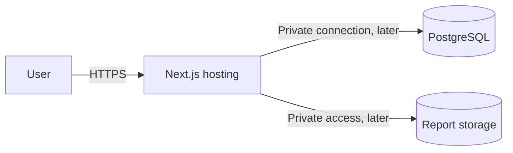

# Deployment architecture

Status: locally buildable frontend demo; hosting pending, updated 2026-09-28. The [MVP freeze](../requirements/MVP-freeze.md) controls product scope. This design records the simplified stack for the current scaffold; unanswered business and security policies remain [NEEDS CLARIFICATION].

## What exists and what is planned

`web/` is a single Next.js application. It can be built now; it has not been deployed. Today's interactive frontend demo has no persistent data or real user accounts. The eventual application needs a host that can run its server operations, a managed PostgreSQL database and private durable report storage. Exact provider, region, budget and real-versus-synthetic-data audience remain Q-003/Q-025.

Do not select static-only export for server-side identity/booking/report features. Check chosen host limits for long uploads, report inspection and database connections before committing. A single-host deployment is simpler than the earlier two-service proxy, but still needs durable data, backups and runtime secrets.

## Environments and configuration

Use local development, isolated staging/preview and production environments as release maturity grows. No production accounts or secrets are created in this phase. Environment files contain local dummy values only if later explicitly needed; real credentials come from protected host configuration. Never put secrets in browser-public variables, source, logs, videos or committed examples.

Run checked, versioned migrations as a controlled release step. Keep app and database versions compatible during rollout. Database backups and private-object recovery must be tested together; container/local disks cannot be the only copy of lab reports. Choose availability, retention and recovery targets after Q-019/Q-022, rather than inventing them.

The configured GitHub Actions workflow runs lint, 15 demo domain tests and TypeScript/build. It has not yet run on GitHub. Later CI must add real service/database integration and browser journey tests. Use a staging smoke test for authentication, booking, lab ownership and disease browsing before a production release. Marketing assets/public claims require a separate accuracy review. Production deployment and publishing occur only through their later concrete tasks.

## Current validation

From the repository root, run `npm run setup` once, `npm run dev` for development, and `npm run check` for lint, tests and optimized build. `npm run typecheck` is available separately. After a build, use `npm --prefix web run start -- --port 3001` to serve it locally. No environment secrets are needed for the demo.

The build can run on a compatible Next.js host with project root `web`, install command `npm ci`, build command `npm run build`, and start command `npm run start` where the platform expects a Node server. No host, account, domain, region or budget has been selected; no deployment was made. Keep the demo labelling if publishing a synthetic preview. Real-data launch remains blocked by the unresolved policies and unimplemented backend.

Database infrastructure now has `npm run db:migrate`, `npm run db:check` and `npm run test:backend`; see [the backend checkpoint](../backend-foundation.md). Availability/appointment migration 0002 requires PostgreSQL `btree_gist`. Account/profile/report/content migrations, backup/restore and real authentication tests remain pending. CI runs 14 real database tests alongside the frontend checks; no remote run is claimed. [Frontend delivery evidence](../frontend-delivery.md) records the earlier UI validation. The CI workflow uses pinned official action revisions and read-only repo permissions; it cannot publish a deployment.
