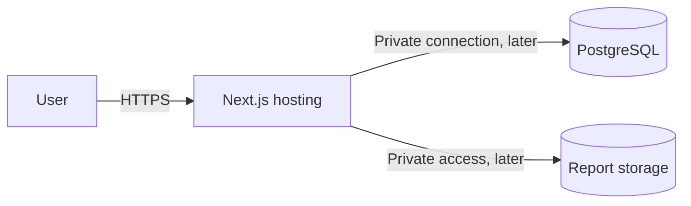

# Deployment architecture

Status: Phase 1 foundation architecture, updated 2026-09-27. The [MVP freeze](../requirements/MVP-freeze.md) controls product scope. This design records the simplified stack for the current scaffold; unanswered business and security policies remain [NEEDS CLARIFICATION].

## What exists and what is planned

`web/` is a single Next.js application. It can be built now; it has not been deployed. Today's static preview has no persistent data or user accounts. The eventual application needs a host that can run its server operations, a managed PostgreSQL database and private durable report storage. Exact provider, region, budget and real-versus-synthetic-data audience remain Q-003/Q-025.

Do not select static-only export for server-side identity/booking/report features. Check chosen host limits for long uploads, report inspection and database connections before committing. A single-host deployment is simpler than the earlier two-service proxy, but still needs durable data, backups and runtime secrets.

## Environments and configuration

Use local development, isolated staging/preview and production environments as release maturity grows. No production accounts or secrets are created in this phase. Environment files contain local dummy values only if later explicitly needed; real credentials come from protected host configuration. Never put secrets in browser-public variables, source, logs, videos or committed examples.

Run checked, versioned migrations as a controlled release step. Keep app and database versions compatible during rollout. Database backups and private-object recovery must be tested together; container/local disks cannot be the only copy of lab reports. Choose availability, retention and recovery targets after Q-019/Q-022, rather than inventing them.

Future CI should run lint, TypeScript/build, relevant unit/integration and browser journey tests. Use a staging smoke test for authentication, booking, lab ownership and disease browsing before a production release. Marketing assets/public claims require a separate accuracy review. Production deployment and publishing occur only through their later concrete tasks.

## Current validation

Inside `web/`, the available commands are `npm run dev`, `npm run lint` and `npm run build`. The build output is a deployable static preview of the current route, not proof of final application readiness. No database migration, backup, authentication or deployment test command exists yet. Document actual commands as those systems are implemented.
