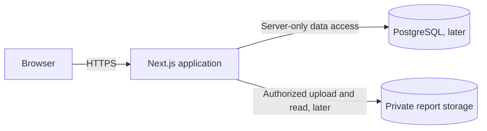

# System architecture

Status: frontend demo implemented; planned server boundaries, updated 2026-09-28. The [MVP freeze](../requirements/MVP-freeze.md) controls product scope. This design records the simplified stack for the current scaffold; unanswered business and security policies remain [NEEDS CLARIFICATION].

## Current direction

One Next.js application in `web/` contains the React interface and server-side application code. TypeScript is used throughout. Tailwind CSS styles the initial interface; shadcn/ui components can be added when a real form or interaction needs them. PostgreSQL will hold durable records once their rules are approved. Report bytes will need private durable storage. There is no separate NestJS application in the current build.

The Next.js frontend now implements connected fictional-data journeys and a component catalog; see [frontend delivery](../frontend-delivery.md). Its in-memory demo provider is not a server or durable session. The arrows to PostgreSQL and report storage show planned boundaries, not deployed resources. Browser code cannot connect directly to either. A server function/route must authenticate, authorize and validate every sensitive operation. UI state never grants permission.

## Responsibility split

Backend infrastructure now includes a server-only PostgreSQL pool, transaction helper, safe error mapping, migrations and isolated local/test database tooling. Availability/appointment tables and internal services enforce occupancy, overlap and lifecycle rules. Profile/account/content/report persistence, API integration and session-derived permissions remain unimplemented. See [the backend checkpoint](../backend-foundation.md) and [tester MVP plan](../tester-mvp.md).

| Layer | Responsibility |
|---|---|
| Browser components | Presentation, forms, interaction feedback; no secret or trusted role logic |
| Next.js server code | Session checks, authorization, runtime validation, business services, safe responses |
| PostgreSQL | Durable identities, profiles, appointments, metadata and integrity constraints |
| Private object storage | Laboratory report bytes; server-mediated permission checks before access |

Keep server-side business functions outside route/page files so a future separate API is possible without making it a current requirement. One source of truth for permissions and booking rules is essential. Do not create shadow product APIs or scaffold excluded features.

## MVP journeys

1. Doctor profile/availability → patient search → physical appointment → authorized doctor management (UC-001–UC-005).
2. Authorized lab report upload → correct patient's private result access (UC-010).
3. Authorized disease information maintenance → eligible reader browsing (UC-008).

The [freeze](../requirements/MVP-freeze.md) lists full IDs and acceptance criteria. Online consultations, electronic prescriptions, payments, diagnosis, lab-test booking and broad doctor history remain outside V1. The current interface demonstrates all three journeys with shared fictional records. Production acceptance remains unfulfilled because identity, server authorization and persistence are not implemented.

## Architecture rules for later phases

- Use server-only database and storage adapters, narrow services per capability and explicit runtime input validation.
- Before a booking write, enforce the approved capacity/conflict policy inside a PostgreSQL transaction with a database constraint or coordinated lock. A browser check is only feedback.
- Do not make a lab report readable until file safety, patient association and publication rules permit it. Metadata and object bytes require reconciliation because their stores do not share one transaction.
- Keep protected responses private and uncached across user changes. Never place session secrets or report bytes into browser storage.
- Errors show safe messages and request identifiers; server logs omit credentials and medical payloads.
- Test complete user journeys with synthetic accounts and a real PostgreSQL test database when those features exist. The specific test commands will be recorded when installed.

See [frontend](frontend-architecture.md), [backend](backend-architecture.md), [security](security-architecture.md), [deployment](deployment-architecture.md) and [decisions](decisions.md). These documents are design guidance, not evidence that unbuilt components exist.
