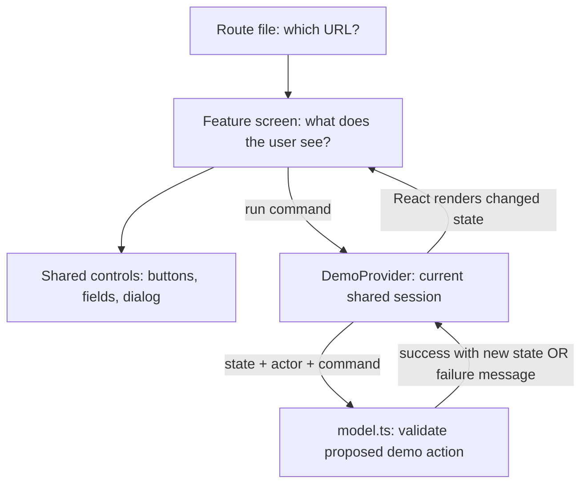

# Learn frontend by understanding PULSE

Current addition (2026-09-29): the product is now Pulse. Start with [the connected app guide](connected-app-guide.md) for server data flow. The memory-only explanations below apply to explicit `APP_MODE=demo`; connected mode persists changes and uses server authentication.

Start here. You do not need to read every requirement file before exploring the app. First use it, then trace one interaction, then make one small change and prove that it works. This guide explains the frontend delivered in September 2026; [the delivery report](frontend-delivery.md) separates demo behavior from the future production application.

## What you have built

PULSE now has a landing page and patient, doctor, laboratory, and content workspaces. They share fictional records: a patient's request becomes a doctor's appointment; a laboratory sample appears in the intended patient's report list; a published demo entry appears in the library.

The current frontend is the visible, interactive part of the application. The browser holds temporary data. It does not securely authenticate people, store appointments permanently, or protect real medical records. Those jobs need server code and durable storage in later tasks. A polished interface and a production healthcare system are different completion milestones.

The visual direction uses translucent panels, background color, blur, fine borders, readable typography and generous spacing. That is glassmorphism implemented in CSS. It does not need an animation engine or a collection of downloaded UI kits.

## First session: use the app

From the repository root:

```bash
npm run setup  # first installation, using web/package-lock.json
npm run dev
```

Open localhost:3000 and choose **Explore patient demo**. Find Maya, pick an available sample slot and submit a request. Open **Demo controls**, switch to Maya, open Appointments and confirm the request. Switch back to Jamie and inspect the same appointment. Keep the same browser tab: reloading intentionally resets everything.

Then open **Follow the journey**. Follow laboratory → patient and content maintainer → reader. The checks represent record changes, not medical outcomes or completed production requirements.

Your first learning goal is to explain what the user inputs, which record changes, and where the result appears. You do not have to memorize syntax to do that. You do need enough syntax to read conditions, data shapes, and event handlers accurately as you encounter them.

## The architecture in plain language



A **component** is a reusable piece of interface. **Props** are inputs passed to it. **State** is data that can change while the app runs. A **route** connects a URL to a screen. A **layout** wraps related screens with shared navigation. A **provider** makes shared state available to descendants. A **pure function** computes a result without changing outside state, making the demo rules easy to test.

TypeScript describes which data shapes code expects. It catches many mistakes during development, but an incoming network request still needs runtime validation. CSS controls layout and appearance. HTML gives controls their meaning; a real button, label or dialog is usually a better starting point than a clickable generic container.

## Trace one booking completely

1. `/doctors/[id]` reads the route's doctor ID and renders `DoctorDetail`.
2. `DoctorDetail` finds that doctor in shared state and displays available slots. A selected date and slot are local state because only this screen needs them.
3. The review dialog shows the intended doctor, location and time before mutation.
4. Confirming calls `run({ type: "book", doctorId, slotId })` from the provider.
5. `applyCommand` checks the demo actor, profile, slot ownership and existing use. A failure returns a message and leaves state unchanged.
6. Success produces a new appointment tied to patient, doctor and slot IDs. The provider updates shared state and displays feedback.
7. Patient and doctor appointment lists filter the same records. Changing the doctor's status updates that record; the patient sees the change after navigation.

The synchronous state reference in the provider prevents two immediate commands from reading the same outdated React snapshot. This is a local demo safeguard. Two people on different computers still require database transactions and constraints on a real server.

## File-by-file map

Paths below are relative to the repository root. Start with the four highlighted responsibilities—routes, screens, state and rules—and return to configuration only when you need it.

### Feature implementation

| File under `web/src/features/pulse/` | Responsibility and reason it exists |
|---|---|
| `model.ts` | Types, fictional seed records, selectors, search and pure command validation. Centralizes demo behavior so separate pages agree. It is not a database or a trusted server. |
| `provider.tsx` | React context, current persona, shared records, notifications, reset and review-state controls. Preserves the demo across client navigation. |
| `public-pages.tsx` | Landing page and registration/login demonstrations. Form passwords remain transient and are not verified or saved; persona entry is explicit. |
| `patient-pages.tsx` | Patient overview/profile, doctor directory/cards/details and booking review/success UI. Combines filters and consumes available slots. |
| `appointments.tsx` | Patient and doctor views of the same appointment records, filters, details and confirmed status changes. |
| `doctor-pages.tsx` | Doctor overview, profile creation/editing, sample schedule management and delete confirmation. |
| `report-pages.tsx` | Laboratory list/preparation, intended-patient review, patient search, text reader and sample download. Local file reads handle errors and competing selections. |
| `content-pages.tsx` | Published library, article reader, maintainer list and create/edit form. Edited copy is visibly unreviewed. |
| `journey.tsx` | Cross-role walkthrough. Buttons choose the relevant fictional persona and page; progress derives from records. |
| `pulse.css` | Product layout, glass materials, responsive breakpoints, status styles, forms and reduced-effects fallbacks. |

### Shared interface

| File | Responsibility |
|---|---|
| `web/src/components/pulse/shell.tsx` | Workspace navigation, current persona, notices, demo controls and role-specific presentation through `Gate`. Hiding a screen here is not authorization. |
| `web/src/components/pulse/primitives.tsx` | Logo, page titles, panels, avatars, status labels, empty states, input errors and native modal dialog. A shared pattern keeps screens consistent. |
| `web/src/components/ui/button.tsx` | Existing standard button with consistent styling and native button behavior. |
| `web/src/components/ui/field.tsx` | Existing label, hint and input wrapper. Labels help mouse, keyboard and assistive-technology users. |
| `web/src/components/ui/badge.tsx` | Existing compact label component, also used in the design catalog. |
| `web/src/components/ui/icon.tsx` | Existing local SVG icon collection, extended for new workspaces. No icon-font download. |

### Every route and layout

All paths in this table are beneath `web/src/app/`. `(product)` is a route group; the parentheses do not appear in URLs. `[id]` is a changing identifier. Thin page files compose features rather than mixing routing, styling and rules in one huge file.

| File | Browser route / purpose |
|---|---|
| `layout.tsx` | Root HTML, metadata, shared CSS imports and `DemoProvider`. |
| `page.tsx` | `/` → landing page. |
| `globals.css` | Existing typography/reset, shared controls and design catalog styling. |
| `login/page.tsx` | `/login` → demo entry form. |
| `register/page.tsx` | `/register` → fictional patient registration form. |
| `not-found.tsx` | Helpful unknown-URL page with a way back home. |
| `(product)/layout.tsx` | Wraps product screens with `Workspace`. |
| `(product)/loading.tsx` | Route loading fallback while Next prepares a page. |
| `(product)/error.tsx` | Unexpected route-error recovery. This installed Next version uses the `retry` prop. |
| `(product)/patient/page.tsx` | `/patient` → dashboard. |
| `(product)/patient/profile/page.tsx` | `/patient/profile` → profile editing. |
| `(product)/patient/appointments/page.tsx` | `/patient/appointments` → patient appointment list. |
| `(product)/patient/reports/page.tsx` | `/patient/reports` → own demo reports. |
| `(product)/doctors/page.tsx` | `/doctors` → searchable directory. |
| `(product)/doctors/[id]/page.tsx` | `/doctors/:id` → profile and booking. Awaits route params; a key resets form state when the doctor changes. |
| `(product)/doctor/page.tsx` | `/doctor` → practice overview. |
| `(product)/doctor/profile/page.tsx` | `/doctor/profile` → profile creation/editing. |
| `(product)/doctor/availability/page.tsx` | `/doctor/availability` → schedule. |
| `(product)/doctor/appointments/page.tsx` | `/doctor/appointments` → appointment management. |
| `(product)/laboratory/page.tsx` | `/laboratory` → laboratory reports list. |
| `(product)/laboratory/upload/page.tsx` | `/laboratory/upload` → local report preparation. No remote upload endpoint exists. |
| `(product)/library/page.tsx` | `/library` → published information. |
| `(product)/library/[id]/page.tsx` | `/library/:id` → article reader. |
| `(product)/content/page.tsx` | `/content` → maintenance list. |
| `(product)/content/[id]/page.tsx` | `/content/new` creates; other IDs edit. A key isolates different entry forms. |
| `(product)/journey/page.tsx` | `/journey` → connected walkthrough. |
| `design-preview/page.tsx` | `/design-preview` → preserves the original three samples for comparison. |
| `design-system/page.tsx` | `/design-system` → existing shared-control reference. |

The earlier `web/src/features/design-preview/design-preview.tsx`, `sample-data.ts` and `design-preview.css` remain a separate visual experiment. They are not another backend or a second production state store.

### Tests, tooling and repository files

| File | Why you need it |
|---|---|
| `web/tests/demo-model.test.ts` | Tests outcomes: combined search, relationships, conflicts, status transitions, profile validation, report ownership and content behavior. |
| `web/tsconfig.test.json` | Compiles the model/tests into `.test-build` for Node's built-in runner. Uses the existing TypeScript package rather than adding a test framework. |
| `web/tsconfig.json` | App TypeScript rules and import aliases; permits the test's `.ts` import and excludes generated test output. |
| `web/package.json` | Installed packages and actual scripts. No new runtime package was needed. |
| `web/package-lock.json` | Exact dependency resolution; metadata matches the renamed package and Node baseline. |
| `web/eslint.config.mjs` | Existing Next/TypeScript linting; generated test output is ignored. |
| `web/.gitignore` | Existing app ignores plus compiled test output. |
| `package.json` | Root convenience commands delegate to `web/`. This is not a second app or npm workspace. Use `npm run setup`, not root `npm ci`. |
| `.nvmrc` | Records Node 22 for development and CI. |
| `.gitignore` | Root protection against accidental environment/dependency/log files. It cannot remove secrets already committed. |
| `.github/workflows/frontend.yml` | Installs from the app lockfile and runs checks on push/PR. Uses pinned official action revisions, read-only repo permission, no deploy credentials. |
| `.github/pull_request_template.md` | Prompts a reviewer-ready explanation and validation evidence. |
| `AGENTS.md` | Project instructions for future coding work; `web/AGENTS.md` also requires reading the installed Next docs. |
| `README.md`, `web/README.md` | Entry points and runnable commands. |
| `CONTRIBUTING.md`, `SECURITY.md` | Review workflow and the current security/disclosure boundary. |

Delivery, architecture, roadmap and learning documents were synchronized. The original requirement policies were not silently approved. The source Word document is preserved. No license, remote repository, hosted service or credentials were created.

## Your build-then-learn path

Each session has a small observable result. Ask the AI to explain the relevant lines, make one bounded change, run checks, then let you explain the result back.

| Session | Read / inspect | Small exercise | You understand it when… |
|---|---|---|---|
| 1. Routes and components | Root page, product layout, shell | Trace `/patient` to its feature without changing code. | You can explain why the sidebar survives navigation. |
| 2. Layout and glass | `pulse.css`, `primitives.tsx` | Change one spacing token, compare wide/narrow sizes, then review or undo your edit. | You can explain background opacity versus backdrop blur and the readability tradeoff. |
| 3. State and inputs | Directory in `patient-pages.tsx` | Predict the result of specialty + city + symptom filters, then try them. | You can distinguish local filter state from shared doctor data. |
| 4. Shared records | `provider.tsx`, booking command | Trace patient → doctor → patient with a single appointment ID. | You can explain why both screens agree without duplicated records. |
| 5. Validation and errors | `model.ts`, booking tests | Explain why a repeated request fails; add a new test only for a real uncovered outcome. | You can state the precondition, action, expected state and error. |
| 6. Accessible interaction | Modal, fields, radio slots | Complete a request using Tab, Space, Enter and Escape. | You can identify focus, labels and a recovery path without a mouse. |
| 7. Files and async behavior | `report-pages.tsx` | Try a generated sample, invalid extension and two rapid selections. | You can explain local file bytes, read failures, stale reads and why real uploads need server checks. |
| 8. Content and trust | `content-pages.tsx` | Draft an explicitly fictional entry, publish it, then unpublish it. | You can distinguish visibility, attribution and clinical review. |
| 9. Testing and review | Tests and CI | Run checks, inspect a small diff, explain what checks cannot prove. | You do not confuse successful compilation with a secure product. |
| 10. Real integration | Security/backend architecture | Draw browser → authenticated service → database for booking. | You can place ownership checks and concurrency constraints on the server. |

## Debugging without blind AI coding

Describe **expected behavior**, **actual behavior**, and **the smallest repeatable steps**. Start at the failing boundary: URL issue → route; appearance → CSS; local input → component state; inconsistent records → provider/model; later network issue → request and server. Read the error before changing dependencies. Never paste secrets or real reports into a debugging prompt.

Useful request:

```text
Explain PULSE's appointment request from screen to model and back, using the actual files. Do not change code yet. Show where local state, shared state, validation and feedback happen. Ask me to predict one failure outcome, then check my explanation.
```

For a bounded change:

```text
I want [one observable change]. Read the current delivery boundary and relevant feature. Explain affected files and tradeoffs, implement only this change, run appropriate checks, and explain the resulting data flow. Give me one small exercise. Do not add product features or packages unrelated to this change.
```

## Commands and what they prove

```bash
npm run lint       # common code mistakes and framework rules
npm run test       # 15 isolated demo domain tests
npm run typecheck  # route types and TypeScript consistency
npm run build      # optimized Next build, including type checking
npm run check      # lint + tests + build
git diff --check   # whitespace errors in your patch
git diff           # inspect tracked edits; also inspect new files from git status
```

After building, stop the development server and run `npm run start`, or use `npm --prefix web run start -- --port 3001` to inspect the production build separately. Lint/build/tests do not prove all browsers work, establish security, certify accessibility, or measure real-world scale. Browser journeys and later server/integration/load tests cover different risks.

## What comes next

Review the demo, then run **P-01** from [the prompt pack](prompt-pack.md) to resolve real account, permission and release policies. The next major implementation is persistence/authentication and server authorization, followed by replacing one demo journey at a time. Keep the interface; do not regenerate the app from scratch. Remove the persona switcher and demo store from any real-data build.

No extra connector is needed to learn or run this frontend. GitHub access is useful when you explicitly publish the repository; a chosen hosting account and database/storage services become relevant at deployment. Figma is optional if you want collaborative design files. Product videos are a separate task using stable synthetic screens; do not add a video library to this app just for marketing.

Being able to build professionally means you can explain, review, test and maintain what the AI generates. Learn syntax as it becomes necessary, but do not skip understanding records, permissions, failures and tradeoffs.
